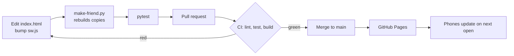
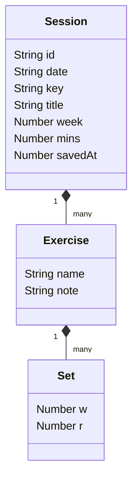

# Road to 3 Plates

My training app: today's lifts with recommended weights, set logging, rest timer, progress toward a 315 bench, food and supplements.

Open it on iPhone in Safari, tap Share, then Add to Home Screen. It opens full screen and works offline.
Logs are saved on the phone. Settings (gear) → Back up now keeps a copy; Restore takes that file or the CSV export. `backups/` has repo-side snapshots.

## Links
- Me: https://ekindeveci1907.github.io/road-to-3-plates/
- Ahmed: https://ekindeveci1907.github.io/Ahmed/ (repo `ahmed`; old link `3-plates` just points there)
- Shayan: https://ekindeveci1907.github.io/road-to-3-plates/shayan/ (folder `shayan/` in this repo)
- Pavle: https://ekindeveci1907.github.io/road-to-3-plates/pavle/ (folder `pavle/` in this repo)

## The plan (v5.6)
Mon Upper A, Wed Lower A, Thu Upper B, Fri Lower B: every muscle twice a week. Big compound lifts get 2–3 hard sets of 6–8; isolation work gets 2–3 sets.
Bench keeps 4–5 sets: Monday top set + 3 back-off sets + 1 wide-grip set; Thursday heavy set + 2 volume sets + 1 wide-grip set.
The wide-grip set is always the last bench set: lighter, 10–12 reps.

Order rules: the day's big lift first, then push and pull take turns so nothing is already burnt out before its next hard lift,
then isolation, with biceps and triceps alternating at the end.

- Mon Upper A: bench (top, back-off, wide) → barbell row → cable fly (2 sets) → pull-ups → DB lateral raise → reverse pec deck → EZ-bar curl → overhead rope extension → Bayesian cable curl → tricep pushdown
- Wed Lower A: squat (top, back-off) → barbell Romanian deadlift (straps) → leg extension → seated leg curl → hip abductor → seated calf raise → decline sit-up (plate behind head) → cable crunch
- Thu Upper B: bench (heavy, volume, wide) → lat pulldown → incline DB press → close-grip cable row → weighted dips → low-to-high cable fly → DB lateral raise → rope face pull → incline DB curl → EZ-bar incline skull crusher → Bayesian cable curl
- Fri Lower B: DB shoulder press (first, fresh) → cable lateral raise → Bulgarian split squat → hip thrust → leg extension → seated leg curl → hip adductor → seated calf raise → DB shrug → back extension → decline sit-up (plate behind head) → cable crunch

Side delts get three days (Mon, Thu, Fri) because they were the one muscle under 10 hard sets a week.

## How targets work
- Every exercise: the heaviest weight from the last time you did it (any day) + 5 lbs, once a week.
- Small shoulder and arm lifts (lateral raises, rear delts, curls, triceps) and the decline sit-up: same weight until every set at that weight hits the top of the rep range, then + 5 lbs. On a 35 lb dumbbell, 5 lbs is a 14% jump, so it's earned with reps first. Already did it earlier this week → same weight. Sets of 2 reps or fewer don't count. No deload week (taken out Nov 23).
- Bench: Monday's top set and Thursday's heavy set are one chain, each 5 lbs more than the last heavy bench (210 Thu → 215 Mon → 220 Thu). Back-off sets, Thursday volume sets and the wide-grip set each follow their own last weight, +5 a week (first wide-grip set: about 75% of the top set). The 11-week table in `BENCH_TOP` is only the starting line; Settings → Your numbers resets it from a new 5-rep max.
- Bodyweight-only (pull-ups): add 5 lbs once every set reaches the top of the rep range.
- "Last time" shows the most recent time you did that exercise, any day. A skipped day (only 0 × 0 sets or just a note) doesn't count. Bench rows show every bench set from that day.
- The Bayesian cable curl keeps its code name `Behind-the-body cable curl`, so Monday and Thursday share one history.
- Wednesday's RDL is the barbell one (`Romanian deadlift`) and carries on from those logs. The dumbbell RDL is still a swap option with its own history, because barbell numbers are the whole bar, not one dumbbell.

## Today tab
- All seven days across the top, opens on today. Tue, Sat and Sun are rest days: a rest page (eat, sleep, chill) that says what's next, offers "Train anyway", and keeps a missed day open until Sunday ("Do Lower B today").
- Mon/Wed/Thu/Fri dots fill in as the week goes. Swipe left or right to move between days.
- A finished exercise folds to one line. Once a workout is saved the bar says "Workout done" with a Review button.
- Left open in the background and opened again on a new day, Today moves to that day (v5.8). A workout you're still logging past midnight stays on screen with its own date.
- Rest timer: silent. When rest is over it shows "Go" and highlights the next set (no beep).
- Progress: weight-gain pace from weekly weigh-in averages, and a 315 countdown from the heavy-bench chain.

## Updating
Every copy is built from this repo's `index.html`. A change goes like this:

1. Make a branch. Edit `index.html`, bump `APP_VERSION` in it and `VERSION` in `sw.js` (phones only update when `sw.js` changes).
2. Rebuild the friends' copies (one codebase, different name and storage prefix):

       python3 tools/make-friend.py Shayan shy shy shayan/index.html shayan/sw.js shayan/manifest.webmanifest
       python3 tools/make-friend.py Pavle  pav pav pavle/index.html pavle/sw.js pavle/manifest.webmanifest
       python3 tools/make-friend.py Ahmed  tpf ahm ../ahmed/index.html ../ahmed/sw.js ../ahmed/manifest.webmanifest --old-link
       python3 tools/make-friend.py Ahmed  tpf tpf ../3-plates/index.html ../3-plates/sw.js ../3-plates/manifest.webmanifest --old-link

3. Run the tests: `pip install -r requirements-dev.txt && python -m playwright install chromium && pytest`
4. Push the branch and open a pull request. CI (`.github/workflows/ci.yml`) runs lint → test → build. Merge only when it's green.
   GitHub Pages publishes `main` about a minute later. Then push the rebuilt files to the `ahmed` and `3-plates` repos.

## Tests
`pytest` runs the real app in a headless Chrome at iPhone size, against all five copies (Ahmed's two are built fresh for the run).
The page gets a test hook (`window.R3P_TEST`, at the end of `index.html`) that hands the tests the app's own functions; on a phone it's never set.
The Google Sheet file (`logs.json`) and exercise photos are stubbed out, so tests only see their own workouts.

- `tests/test_targets.py`, `tests/test_plan.py` (unit): suggested weights, "last time", the weekly plan.
- `tests/test_backup.py` (integration): CSV export ↔ restore, JSON restore, never losing or duplicating a workout.
- `tests/test_copies.py` (system): every copy opens clean, each person only sees their own workouts, logging and saving a set, an update never touches saved workouts.
- `tests/test_build.py` (build): committed friend copies match a fresh build, no Eko data in them, the script parses, offline files exist.
- `tests/test_real_backup.py`: restores a real phone export end to end. Skipped unless you run `R3P_BACKUP=path/to/export.csv pytest tests/test_real_backup.py`.

Lint: `npm ci && npm run lint` (ESLint on the app script; errors block, code-smell warnings like very complex functions don't) and `ruff check tests tools`.
Known smell: the main click handler is one function with about 100 branches. Split it up before adding many more buttons.

## How the data is stored
Each copy keeps its data in the phone's localStorage under its own prefix, because all copies live on the same website:
`r235` (Eko), `tpf` (Ahmed, both links), `shy` (Shayan), `pav` (Pavle). Keys: `<prefix>.sessions`, `.bw` (body weight), `.checks`, `.drafts`, `.profile`.

A session's `id` is `date-key` (e.g. `2026-11-18-lowerA`; old-plan workouts use `old`). `w` is pounds (`null` or `0` is bodyweight), `r` is reps.
A saved entry the app can't read is copied to `<key>.unreadable` before anything could replace it, and the app says so.
Restoring never deletes anything: a workout from a backup only comes in if the phone doesn't have it (or, for the JSON backup, if the backup's copy was saved later).
